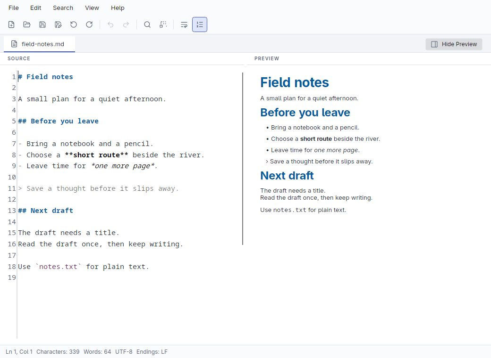

# Tangopad

Tangopad is an offline-first desktop editor for plain text, Markdown, and Redmine Textile.
Edit local files, search and replace text, and preview markup beside its source.
No account is required.

**Pre-release:** The first stable release is not yet published.
Candidate packages target Windows x64, Linux x64, and macOS x64 and arm64.
See [installation and platform limits](docs/user/install.md) before choosing a package.



Linux development build after the interface redesign. This is a real application capture.
[Capture details and release review](docs/product-documentation.md) identify its source and validation limits.

- Edit one UTF-8 document with undo, redo, explicit save, and unsaved-change confirmation.
- Find literal text, whole words, or regular expressions. Replace all in one undo operation.
- Highlight Markdown, Textile, JSON, XML, XAML, YAML, CSV, and TSV source.
- Preview supported Markdown and Textile without loading images or following document links.
- Choose light or dark appearance, Word Wrap, line numbers, and font zoom.
- Reopen recent files and keep preferences in per-user or portable storage.

## Get started

Read the [user guide](docs/user/README.md) for installation, a first editing session,
shortcuts, and troubleshooting. Use [GitHub Releases](https://github.com/daniel-kindl/tangopad/releases)
for published artifacts when available. CI candidate artifacts are for testing.

There are no tabs, exports, autosave, or automatic recovery of unsaved document text.
Save important work regularly. The [limitations](docs/user/troubleshooting.md#known-limitations)
include preview bounds and outstanding accessibility checks.

## Build and contribute

Install the exact .NET SDK in [global.json](global.json).
From the repository root, run:

```sh
dotnet msbuild eng/verify.proj
dotnet run --project src/Editor.App --configuration Release
```

Verification requires NuGet network access and native desktop prerequisites.
Read [the developer guide](docs/development.md) for Windows, Linux, and macOS setup,
repository layout, CI, and release work.
[CONTRIBUTING.md](CONTRIBUTING.md) defines the contribution and review workflow.

[Report a bug](https://github.com/daniel-kindl/tangopad/issues/new/choose) with the
application version, OS, steps, and expected result. Remove private document text
and paths before attaching logs or screenshots.
For a suspected vulnerability, use
[GitHub private vulnerability reporting](https://github.com/daniel-kindl/tangopad/security/advisories/new)
if available. Otherwise, open an issue that asks for a private contact without disclosing exploit details or secrets.

Tangopad uses the [MIT license](LICENSE).
It builds on Avalonia, AvaloniaEdit, CommunityToolkit.Mvvm, Markdig, Velopack, and Lucide icons.
The [third-party notices](docs/licenses) accompany their applicable components.
