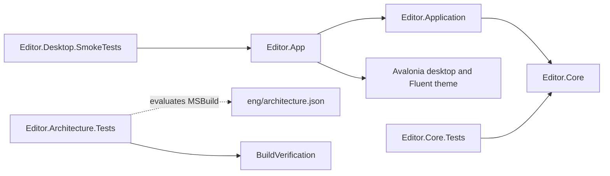

# Architecture

Tangopad uses a modular monolith. Orthogonality takes priority over code reuse.
Each module owns a distinct decision. Dependencies point toward the domain and
application contracts. The domain owns no UI, parser, renderer, or filesystem implementation.

## Current boundaries

The solid arrows below are project references. Core owns plain-text document
behavior. Application reserves use-case ownership without speculative interfaces.

| Module | Ownership | Current implementation |
| --- | --- | --- |
| Editor.App | Presentation and composition | Avalonia startup and an empty window |
| Editor.Application | Use cases and contracts needed by those use cases | Project reference to Core |
| Editor.Core | Document rules and domain types | TextDocument identity, exact text, and clean baseline |
| Editor.Core.Tests | Document behavior | Identity, edits, acknowledgement, reversion, Unicode, and null input |
| Editor.Architecture.Tests | Repository dependency constraints | Solution inventory and evaluated dependency tests |
| BuildVerification | Managed build reproducibility | Creates isolated builds and compares project DLL and portable PDB hashes |
| Editor.Desktop.SmokeTests | Native startup of the blank shell | Starts the built Editor.App executable, closes its native window, and checks exit code 0 |

`Program.Main` is the single composition root. `App` performs framework lifecycle
setup only. No service container is necessary while there are no services.
Application and Core reference no NuGet packages. Production code never references tests.
`Editor.Desktop.SmokeTests` references `Editor.App` so the shell builds first.
The test starts that executable. It does not call shell types.

## Future boundaries

Create a module when a real use case requires it. Update the dependency policy
and ADR before adding its implementation. These are intended permissions, not existing references:

- `Editor.Infrastructure` may reference Application and Core. It owns persistence adapters.
- `Editor.Formats.Markdown` may reference Application and Core. It owns Markdown format policy and parser adaptation.
- App may reference concrete adapters to compose them.
- Adapters cannot reference App or one another.
- Core references no project. Application references only Core.

Format handling identifies format-specific capabilities. Parsing converts source
text into a format representation. Rendering converts a representation into output.
Keep those responsibilities separate when implemented. Do not expose Avalonia or
Markdig types in Core or Application contracts. Add a rendering module only when
its actual consumers establish the boundary. Plain text does not need a format module yet.

## Enforced constraints

[eng/architecture.json](../eng/architecture.json) is the authoritative current
project and direct-package graph. Architecture tests evaluate MSBuild in Debug
and Release. They compare exact project and package references with the policy.
They reject direct assembly references and framework references beyond the .NET base framework.
They also require the solution and policy to contain every project under `src`, `tests`, and `eng`.
The exact acyclic policy excludes cycles and production references to tests.

`BuildVerification` is an engineering tool with no package or production project references.
Architecture tests reference the tool to test its comparison behavior.

These checks include imported and conditional MSBuild items for the evaluated
configurations on the host OS. The CI matrix evaluates all three host systems.
They do not inspect arbitrary runtime-specific configurations.
An API-level test also inspects the compiled Core assembly. It permits only
`System.Runtime` references and a small set of runtime and metadata namespaces.
It prohibits native imports. This excludes `System.IO`, Avalonia, rendering
libraries, and external format parsers, including filesystem types from the base runtime.
See [ADR 0004](adr/0004-plain-text-document.md) for the allowlist and its limits.
Review semantic ownership alongside automated dependency checks.

## Design policy

Keep one authoritative rule in its owning module. Do not extract a shared
abstraction because two code blocks look similar. Prefer a smaller public API
that hides a concrete implementation decision.

Use patterns only for an observed need. Strategy can separate interchangeable
format policies. Adapter can isolate a parser or filesystem library. Commands,
observers, factories, decorators, and DI containers remain deferred until their
cost solves a demonstrated problem. The bootstrap introduces none of these.

A new requirement can reveal a wrong boundary. Change the design and migrate
callers together. Avoid permanent compatibility layers inside this monolith.

See [ADR 0001](adr/0001-module-boundaries.md) for the alternatives and decision.
See [ADR 0004](adr/0004-plain-text-document.md) for document use cases and invariants.
