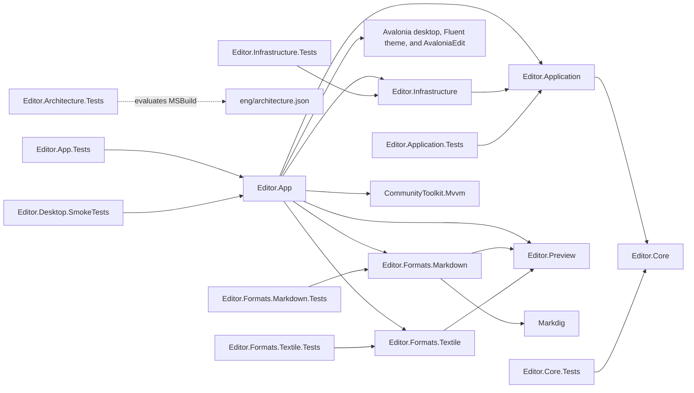

# Architecture

Tangopad uses a modular monolith. Orthogonality takes priority over code reuse.
Each module owns a distinct decision. Dependencies point toward the domain and
application contracts. The domain owns no UI, parser, renderer, or filesystem implementation.

## Current boundaries

The solid arrows below are project references. Core owns document text behavior
and filename-based format identification. Application owns plain-text load and
save orchestration and its persistence port.

| Module | Ownership | Current implementation |
| --- | --- | --- |
| Editor.App | Presentation and composition | Compiled AXAML, EditorViewModel, semantic resources, desktop dialogs, and composition |
| Editor.Application | Use cases and contracts needed by those use cases | DocumentSession load and save through ITextDocumentStore, with destination-derived format and an optional file monitor contract |
| Editor.Core | Document rules and domain types | TextDocument identity, exact text, clean baseline, and document format identification |
| Editor.Preview | Inert preview data | Text, table, and run records without actions or resource destinations |
| Editor.Formats.Markdown | Markdown parsing | Bounded Markdig adapter without UI or resource loading |
| Editor.Formats.Textile | Textile parsing | Bounded baseline parser without UI, packages, or resource loading |
| Editor.Infrastructure | Local persistence and monitoring | Strict UTF-8 document storage, bounded recent-path storage, and optional file events with revision checks |
| Editor.Formats.Markdown.Tests | Parser behavior | Baseline syntax, hostile text, and resource limits without Avalonia |
| Editor.Formats.Textile.Tests | Parser behavior | Textile fixtures, hostile text, and resource limits without Avalonia |
| Editor.App.Tests | Presentation and control behavior | Commands, cancellation, pending-save edits, and headless AvaloniaEdit integration |
| Editor.Infrastructure.Tests | Real filesystem integration | Encoding, replacement, failure, cancellation, cleanup, and session state |
| Editor.Application.Tests | Application behavior | Exact load and save, destinations, errors, cancellation, and pending-save edits |
| Editor.Core.Tests | Document behavior | Identity, edits, acknowledgement, reversion, Unicode, and null input |
| Editor.Architecture.Tests | Repository dependency constraints | Solution inventory and evaluated dependency tests |
| Editor.Desktop.SmokeTests | Native editor startup | Starts the built Editor.App executable, closes its native window, and checks exit code 0 |

`EditorViewModel` owns observable state and commands through CommunityToolkit.Mvvm.
It references no Avalonia controls, resources, or brushes.
The window binds state and commands. EditorBufferAdapter integrates AvaloniaEdit text and document identity.
DesktopEditorDialogs owns native pickers and owned dialogs.
[Presentation resources](presentation-resources.md) defines the resource policy.

`Program.Main` is the single composition root. `App.axaml` owns the theme resources.
App code-behind performs framework lifecycle setup only. The document service receives its persistence port directly. No service container is necessary.
AppStateStore in Infrastructure owns versioned binary state and one shared writer.
RecentFileHistory keeps recent paths separate from document semantics.
See [application state](app-state.md) for mode selection and migration.
The ViewModel exposes history commands and snapshots. See [recent files](recent-files.md)
for storage format, placement, concurrency, and privacy decisions.
EditorPreferences in Infrastructure stores editor presentation preferences separately.
See [editor preferences](editor-preferences.md) for startup precedence, storage, and privacy.
Application and Core reference no NuGet packages. Production code never references tests.
Infrastructure references Application only and adds no packages.
Editor.Formats.Markdown references Markdig and Editor.Preview.
Editor.Formats.Textile references Editor.Preview only.
Neither format parser references the other. Editor.Preview has no project or package dependencies.
App selects the parser from the session format and renders inert records with native controls.
`Editor.Desktop.SmokeTests` references `Editor.App` so the shell builds first.
The test starts that executable. It does not call shell types.

## File placement

Choose the owning layer and directory before creating a file. Extend an existing
feature directory when it fits. Directory changes do not create new architectural
layers or change the dependency policy in `eng/architecture.json`.

| Project | Current placement | Rule as the project grows |
| --- | --- | --- |
| Editor.Core | `TextDocument.cs`, `DocumentFormat.cs`, and `DocumentFormats.cs` at the root | Group related domain types under a feature such as `Documents/`. |
| Editor.Application | `DocumentSession.cs` and `ITextDocumentStore.cs` at the root | Group use cases and their contracts under a feature such as `Documents/`. |
| Editor.Infrastructure | `FileTextDocumentStore.cs` at the root | Group external-system implementations by capability, such as `Persistence/`, `Logging/`, or `Metadata/`. |
| Editor.App | Presentation directories below | Use responsibility directories now. Add feature directories within them when a feature needs a distinct group. |

Keep a project shallow while it has only one or two closely related source files.
Create a directory when it groups related files or gives concrete planned work a
durable home. Do not create empty directories or force symmetry between projects.
Keep project files, package lock files, and assembly metadata at the project root.

Editor.App uses these directories:

- `Views/` contains `EditorWindow.axaml` and its code-behind. `EditorBufferAdapter`
  stays beside its consuming view because it connects that window to AvaloniaEdit.
  `EditorWindow` also owns desktop file-drop validation and routes accepted paths
  to the existing ViewModel Open workflow. See [file drops](file-drop.md).
  `SourcePreviewAdapter` also stays beside the view. It schedules parsing and renders native preview text and tables.
  `SourceHighlightingAdapter` and its embedded `Markdown.xshd` and `Textile.xshd`
  definitions also stay here. `Json.xshd` adapts AvaloniaEdit JSON rules.
  `Yaml.xshd`, `Csv.xshd`, and `Tsv.xshd` define lexical source highlighting without parsers.
  XML and XAML use the XML definition from the pinned AvaloniaEdit package. The adapter selects visual highlighting from the session format.
- `Views/Dialogs/` contains each dialog's AXAML and adjacent code-behind.
- `ViewModels/` contains `EditorViewModel`, `SearchViewModel`, and the search
  consumer's `ISearchBuffer` contract and `SearchMatch` value.
- `Services/` contains `IEditorDialogs`, its `UnsavedDecision` result, and
  `DesktopEditorDialogs`, which implements the desktop interaction contract.
- `Resources/` contains text, tokens, theme dictionaries, `EditorLabels`, and
  `PresentationResources`. The labels keep resource lookup outside ViewModels.
- `Styles/` contains control styles. `App.axaml`, its code-behind, and `Program.cs`
  remain at the root for startup and composition.

Add `Controls/` only for a reusable presentation control or behavior. Add a
presentation `Models/` directory only when concrete presentation-only types need
one. Domain models remain in Core. Avoid generic `Common/`, `Helpers/`,
`Utilities/`, `Managers/`, `Interfaces/`, and `Adapters/` directories.
An interface belongs with its consumer's use case or presentation responsibility.

Domain rules belong in Core. Application owns use cases and their contracts.
Infrastructure owns storage, network and data providers, and concrete logging
providers. Logger abstractions belong in the consuming layer unless a concrete
use case requires a separate framework-neutral contract. Core must not depend on
an infrastructure logging package. App owns Avalonia views, ViewModels, UI bridges,
and diagnostic presentation. AvaloniaEdit adapters therefore belong in App.

Tests follow architectural ownership and observable behavior. `Editor.App.Tests`
groups command tests under `ViewModels/` and headless control tests under `Views/`.
The other test projects remain shallow while they cover one coherent concern.
The desktop smoke project keeps its startup probes together at the root.
Add feature groups when they improve navigation, without a parallel tree of empty
or redundant directories.

Align new namespaces with meaningful directories. Preserve existing public type
identity when a file move alone is sufficient. This layout keeps the public Core,
Application, and Infrastructure namespaces unchanged. App's internal namespaces
follow its directories, including the matching AXAML `x:Class` values and compiled
binding namespace. Projects, resource dictionaries, and executable paths retain
their existing identities. Resource checks scan AXAML recursively.

Record directory and namespace placement in new issues and pull request reviews.
For each move, check consumers, compiled bindings, resource URIs, test fixtures,
native acceptance scripts, and build tooling. Update affected references together.

## Format and preview boundaries

Editor.Formats.Markdown owns Markdown parser adaptation at its project root.
Its namespace is `Editor.Formats.Markdown`.
See [ADR 0008](adr/0008-safe-markdown-preview.md) for limits, security, and dependency rationale.

Editor.Formats.Textile owns the bounded Textile parser at its project root.
Its namespace is `Editor.Formats.Textile`.
Editor.Preview owns the shared display records at its project root, with namespace `Editor.Preview`.
Neither module owns format identification, scheduling, or UI controls.
See [ADR 0010](adr/0010-safe-textile-preview.md) for parser assessment and shared data ownership.
[Textile preview](textile-preview.md) defines the supported baseline and limits.

## Future boundaries

Create a module when a real use case requires it. Update the dependency policy
and ADR before adding its implementation. These are intended permissions, not existing references:

- Format modules may reference Application and Core when a use case needs their contracts. The current parsers reference neither. Filename classification remains in Core.
- App may reference concrete adapters to compose them.
- Adapters cannot reference App or one another.
- Core references no project. Application references only Core.

Format handling identifies format-specific capabilities. Parsing converts source
text into a format representation. Rendering converts a representation into output.
Keep those responsibilities separate when implemented. Do not expose Avalonia or
Markdig types in Core or Application contracts. Add a rendering module only when
its actual consumers establish the boundary. Plain text does not need a format module yet.

## Enforced constraints

[eng/architecture.json](../eng/architecture.json) is the authoritative current
project and direct-package graph. Architecture tests evaluate MSBuild in Debug
and Release. They compare exact project and package references with the policy.
They reject direct assembly references and framework references beyond the .NET base framework.
They also require the solution and policy to contain every project under `src`, `tests`, and `eng`.
The exact acyclic policy excludes cycles and production references to tests.

These checks include imported and conditional MSBuild items for the evaluated
configurations on the host OS. The CI matrix evaluates all three host systems.
They do not inspect arbitrary runtime-specific configurations.
API-level tests inspect the compiled Core and Application assemblies.
Core may reference only `System.Runtime`.
Application may reference only `Editor.Core` and `System.Runtime`.
That check rejects Avalonia, rendering libraries, and external format parsers.
The namespace check permits only the allowlists in ADR 0004 and ADR 0005.
That check rejects `System.IO`, including filesystem types from the base runtime.
The native-import check rejects methods that import native code.
The type-definition check requires inner modules to define types in their own namespaces.
See [ADR 0004](adr/0004-plain-text-document.md) and
[ADR 0005](adr/0005-document-persistence-use-cases.md) for the allowlists and their limits.
Review semantic ownership alongside automated dependency checks.

## Design policy

Keep one authoritative rule in its owning module. Do not extract a shared
abstraction because two code blocks look similar. Prefer a smaller public API
that hides a concrete implementation decision.

Use patterns only for an observed need. Strategy can separate interchangeable
format policies. Adapter can isolate a parser or filesystem library. Commands,
observers, factories, decorators, and DI containers remain deferred until their
cost solves a demonstrated problem. The bootstrap introduces none of these.

A new requirement can reveal a wrong boundary. Change the design and migrate
callers together. Avoid permanent compatibility layers inside this monolith.

See [ADR 0001](adr/0001-module-boundaries.md) for the alternatives and decision.
See [ADR 0004](adr/0004-plain-text-document.md) for document use cases and invariants.
See [ADR 0005](adr/0005-document-persistence-use-cases.md) for persistence contracts and save concurrency limits.
See [ADR 0006](adr/0006-local-text-persistence.md) for UTF-8, replacement, metadata, and platform limits.

See [ADR 0007](adr/0007-plain-text-editor.md) for UI synchronization and desktop command behavior.

[Document formats](document-formats.md) defines extension mapping and session format transitions.

See [ADR 0009](adr/0009-optimistic-file-concurrency.md) for disk revisions and explicit conflict choices.

[External file notifications](external-file-notifications.md) defines the optional monitor port,
local watcher, presentation lifecycle, and save-time authority.
