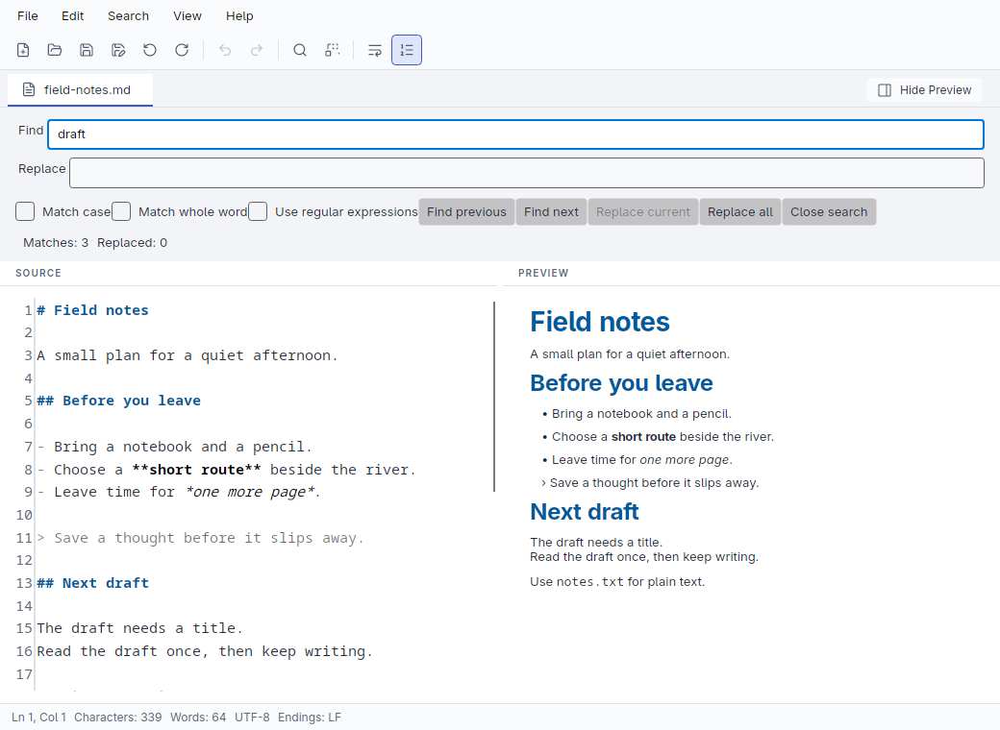

# Editor reference

## Search and replace

**Search > Find** opens the search panel. **Search > Replace** also shows replacement controls.
Type the query, then use **Find next** or **Find previous**.
Enter searches forward from a search field. Shift+Enter searches backward.
Both directions wrap at the document boundaries. Escape closes the panel and returns focus to the editor.

Literal search is the default. Replacement text is literal in this mode.
**Match case** selects case-sensitive matching.
**Match whole word** excludes matches inside words, identifiers, and adjacent Unicode letters or digits.
It treats apostrophes and hyphens as separators. It does not perform language-aware word segmentation.

**Replace current** requires an exactly selected match.
**Replace all** changes non-overlapping matches from left to right and reports the count.
One Undo restores the whole replacement operation.
Inserted text is not searched again during that operation.

The development capture shows literal search. The procedure above provides the same workflow without images.

### Regular expressions

Enable **Use regular expressions** for .NET patterns.
For example, `item-(\d+)` with replacement `entry-$1` changes `item-001` to `entry-001`.
Named captures use `${name}`. `$&` inserts the full match. `$$` inserts a dollar sign.
An unknown capture or unsupported substitution disables replacement.
In replacement text, `\n` stays a backslash followed by `n`. Paste an actual newline to insert one.

Patterns that match empty text are rejected. Timeouts and size limits produce feedback without partial edits.
The source limit in regex mode is 1,000,000 UTF-16 code units.
Use literal mode for larger documents or simplify the query when a limit appears.
[Search behavior](../find-replace.md#regular-expressions) lists exact syntax and execution limits.
Search options stay in the current window. They are not saved as preferences.

## Navigate and read status

**Search > Go To Line** accepts a whole number from 1 to 2147483647.
A number beyond the last line goes to the beginning of that last line.
Enter confirms. Cancel, Escape, or closing the dialog preserves the caret and selection.
The shortcut operates when the source editor has focus.

The status bar shows caret line and column, words, characters, encoding, and line endings.
Line endings can be LF, CRLF, CR, Mixed, or None.
Word Wrap does not change logical line numbers or saved line endings.

Characters count Unicode scalar values. An emoji such as `😀` counts as one.
A letter and a combining mark count separately. CRLF counts as two characters.
Words are non-whitespace sequences separated by Unicode whitespace.
Counts include markup source and punctuation. They do not count rendered words or visible glyphs.

## Change appearance

| Control | Default | Persistence |
| --- | --- | --- |
| View > Word Wrap | Off | Saved across restarts |
| View > Line numbers | On | Saved across restarts |
| View > Zoom In, Zoom Out, Reset Zoom | Font size 15, range 8 through 48 | Saved across restarts |
| View > Appearance | Follow System | Current window only |

Appearance offers **Follow System**, **Light**, and **Dark**.
Font zoom changes source text size. It does not change document content or OS display scale.
Word Wrap fits long source lines to the editor width.
Presentation changes preserve source text and undo history.
There is no general preferences dialog.

## Markup and source highlighting

| Filename extension | Source highlighting | Preview |
| --- | --- | --- |
| `.md`, `.markdown` | Markdown baseline | Bounded read-only Markdown |
| `.textile` | Redmine Textile baseline | Bounded read-only Textile |
| `.json` | JSON | None |
| `.xml`, `.xaml` | XML | None |
| `.yaml`, `.yml` | YAML baseline | None |
| `.csv`, `.tsv` | Delimiter-oriented highlighting | None |
| `.txt`, unknown extensions, or Untitled | Plain text | None |

Extension matching ignores case. Save an untitled document with the appropriate extension to select its format.
Highlighting changes display only. It does not validate, reformat, or repair data.
`.wiki` does not select Textile. There is no export command.

Select **Show Preview** for Markdown or Textile. Preview starts hidden.
A format change hides it. Source editing remains authoritative.
Both previews keep resource links inactive and do not load images, scripts, or external documents.
They do not reproduce every feature of a browser or a Redmine server.

Markdown supports headings, paragraphs, emphasis, lists, quotes, code, and thematic breaks.
HTML stays literal. Markdown tables, task controls, diagrams, and image display are unsupported.
Textile has a separate parser with native table support and bounded Redmine references.
Server macros appear as named placeholders.

Both previews limit input to 32,768 UTF-16 code units.
A resource-limit message means preview is incomplete. Continue editing and saving in source view.
See [Markdown preview policy](../adr/0008-safe-markdown-preview.md),
[Textile preview](../textile-preview.md), and [structured-text highlighting](../structured-text-highlighting.md) for exact limits.

## Encoding and file contents

Open decodes strict UTF-8. It rejects malformed input and does not automatically convert UTF-16 or legacy encodings.
One initial UTF-8 BOM is consumed on load. Save does not add a BOM.
Existing text, whitespace, and line-ending sequences are not normalized.
Saving does not add a final newline.
This preserves text, but does not promise byte identity for a BOM-bearing input.

Save replaces the destination with a new file after preparing complete UTF-8 output.
The old file's permissions, ACLs, timestamps, alternate streams, and hard-link identity are not preserved.
Loading follows symbolic links. Saving replaces a final symbolic link rather than its target.
Use ordinary local files and keep backups when metadata matters.
[Persistence policy](../adr/0006-local-text-persistence.md) records filesystem and power-loss limits.
