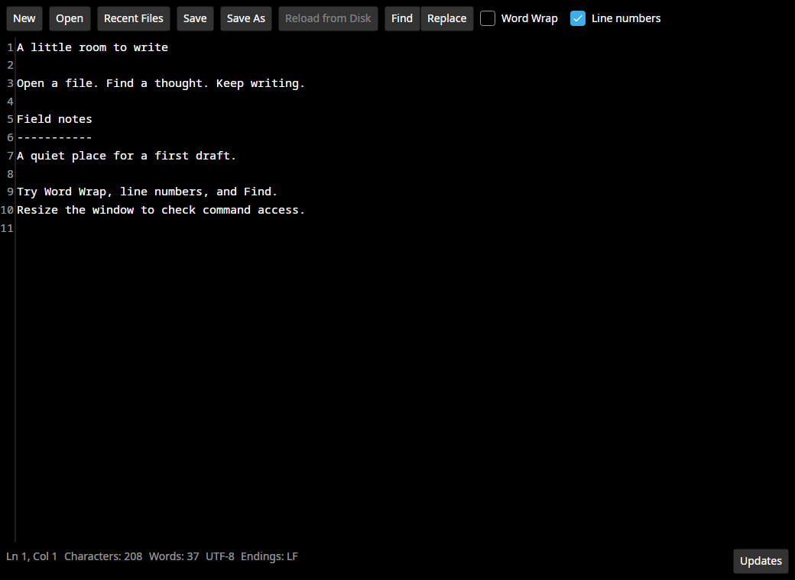
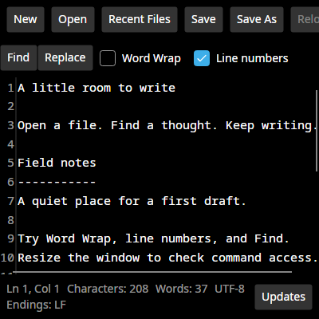
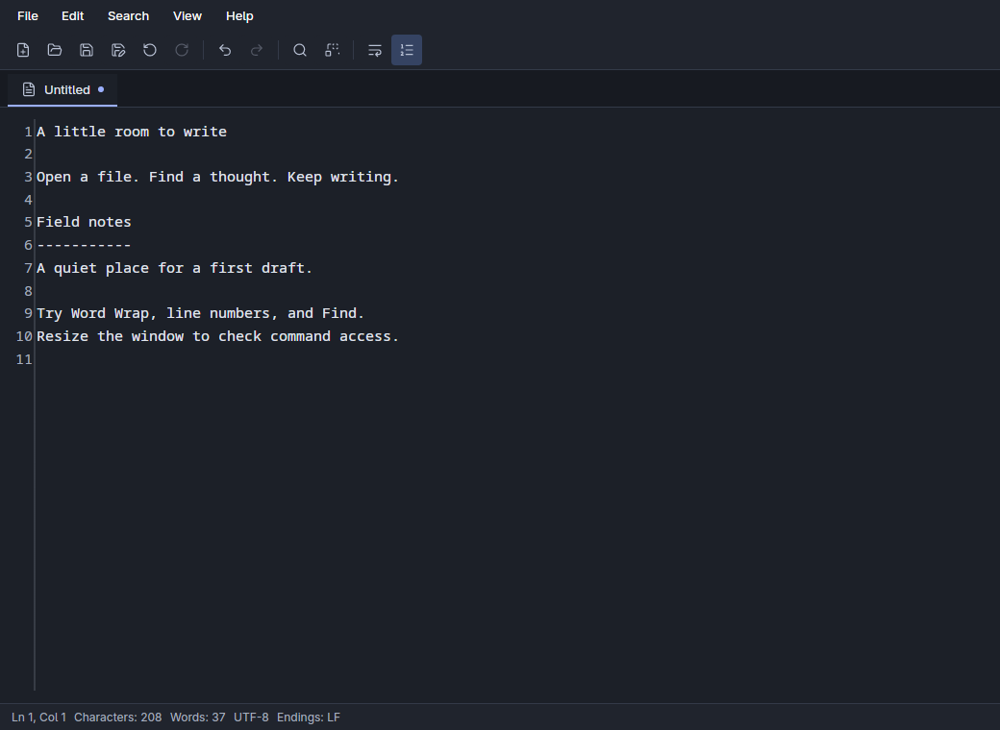
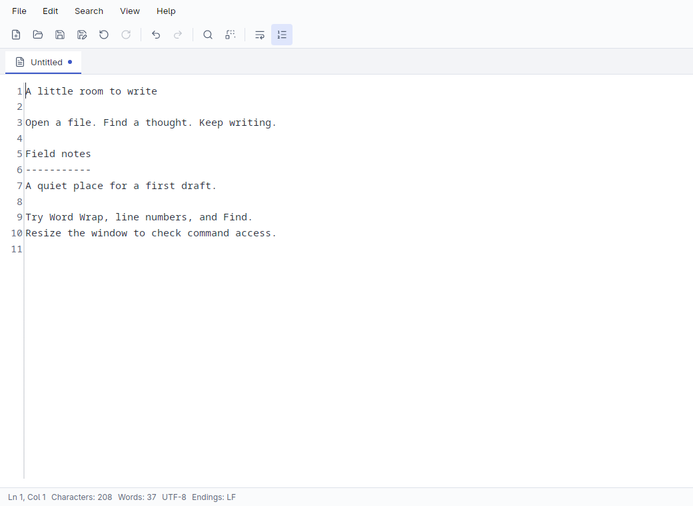
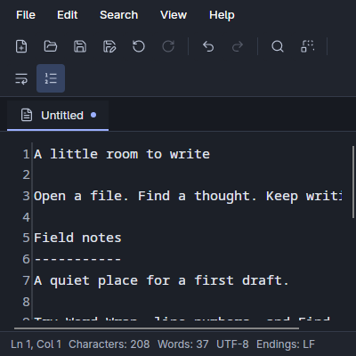
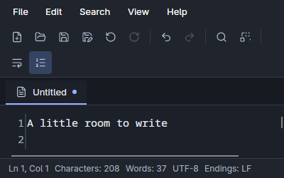
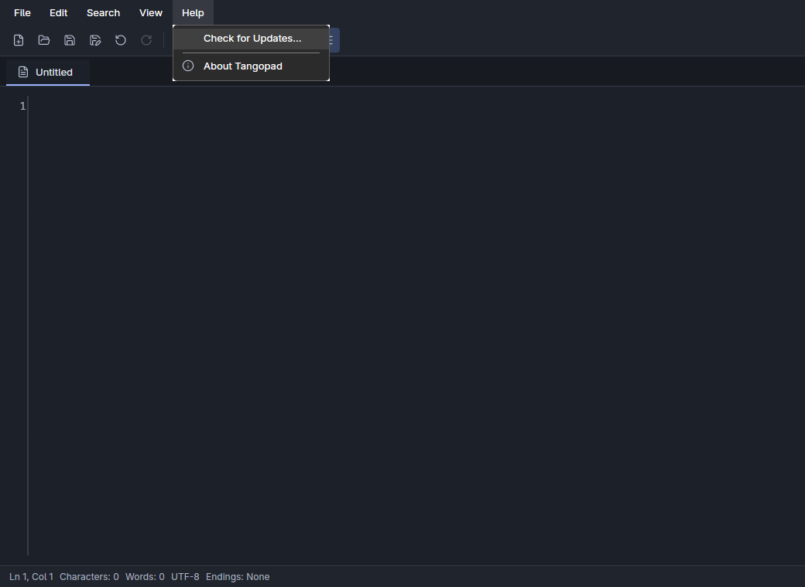
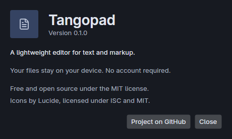

# Interface design draft

Issue [#47](https://github.com/daniel-kindl/tangopad/issues/47) is a design milestone.
The shell merged in [PR #101](https://github.com/daniel-kindl/tangopad/pull/101).
[Accessibility and display acceptance](47-acceptance.md) tracks the remaining checks.
The design remains open to revision. It does not complete cross-platform acceptance.

## Current-state audit

The baseline is `dev` commit `2ac02b8`.
The audit covers the existing views, resource dictionaries, and control tests.
Screenshots show Linux X11 windows without native window decorations.
Before and after screenshots use the same document and window dimensions.

| Area | Baseline finding | Priority | Current treatment |
| --- | --- | --- | --- |
| File actions | One horizontal group extends past narrow windows. | High | Compact icon actions wrap. File commands also appear in menus. |
| Command discovery | Go To Line and zoom require shortcut knowledge. There is no menu bar. | High | Add File, Edit, Search, View, and Help menus with shortcut labels. |
| Hierarchy | File actions, search, preview, and preferences share one toolbar. | High | Separate menus, toolbar, document context, and status. |
| Document context | The path appears in the native title only. | Medium | Add an active document tab with a filename and an unsaved marker. |
| Reading area | Document and application chrome share a general surface role. | Medium | Add a separate canvas and neutral shell palette. |
| Preview | Split panes have no headings. | High | Add source and preview headings when the split is open. |
| Find and Replace | Several rows contain simultaneous options and feedback. | High | Preserve behavior and labels. Review a smaller search layout separately. |
| Recent files | A flyout contains local paths and privacy information. | Medium | Retain the flyout and add a File submenu. |
| Unsaved edits and conflicts | Existing decisions protect edits and exact persistence. | High | Preserve decisions and keyboard behavior. |
| External changes | A nonblocking banner offers Reload and Dismiss. | Medium | Retain recovery actions below document context. |
| Updates | A permanent bottom button opens update controls. | Medium | Move the entry to Help and show status in an update dialog. |
| Product information | No About dialog exists. | Medium | Add build version, project information, and license credits under Help. |
| Typography and icons | Commands rely on text buttons and framework defaults. | High | Use one UI font hierarchy and one vendored Lucide icon subset. |
| Themes | Semantic dictionaries exist, with platform theme selection. | High | Add coherent light and dark palettes and an Appearance submenu. |
| Accessibility | Existing labels and keyboard commands have tests. | High | Preserve names, add named icons, and test menu actions and focus recovery. |

### Before

### Proposed shell

## Design direction

The primary use case is an exact edit to a local file.
A second use case is Markdown or Textile authoring with optional preview.
These proposed use cases follow existing functionality, without user-research validation.

Notepad++ informs command discovery through menus and a compact toolbar.
Kate informs the explicit source and preview context.
Sublime Text and Atom inform the quieter document tab, typography, and neutral chrome.
These references guide the structure. Tangopad retains its existing single-document workflow.

The menu bar owns the complete command list.
The toolbar provides named, accessible shortcuts for frequent actions.
The active tab shows the document filename and unsaved state.
Preview is a document action at the right of the tab strip.
The bottom bar contains document status only.
Native decorations and file pickers retain platform ownership.

## Tokens and components

Presentation stays in `Editor.App`.
Resources and styles own typography, brushes, spacing, icon geometry, and control appearance.
Views own menus, the document shell, and dialogs.
ViewModels retain document commands and update state.
There are no new project references or package dependencies.

| Element | Specification |
| --- | --- |
| Default window | 1040 × 760 logical pixels. Minimum remains 400 × 250. |
| UI typography | A shared 13-pixel sans-serif hierarchy with Inter, Segoe UI, Adwaita Sans, and Noto Sans fallbacks. |
| Source typography | Existing monospace font and 15-pixel initial size. Existing zoom controls remain available. |
| Menu bar | File, Edit, Search, View, and Help. Platform-specific command gestures appear beside commands. |
| Toolbar | 32-pixel icon targets, separators between command groups, and command-name tooltips. |
| Icons | A pinned Lucide subset, rendered as 16-pixel vectors on a 24-pixel grid with consistent strokes. |
| Document tab | Filename, file icon, and unsaved marker. The active tab uses an accent underline. |
| Preview | Explicit source and preview headings, a resizable divider, and existing inert content rendering. |
| Status | Shared 12-pixel text for caret, counts, encoding, and line endings. Items wrap at narrow widths. |
| Light theme | Pale neutral chrome, white canvas, dark text, and blue accents. |
| Dark theme | Graphite chrome, a dark canvas, pale text, and muted blue accents. |
| Appearance | View selects system, light, or dark appearance for the current window. |
| About | Help opens the actual build version, project link, and license credits. |
| Updates | Help opens update status and starts an available check. Existing verification and install safeguards remain in place. |
| Motion | No new animation. |

`Resources/Icons/source.json` records the Lucide revision and selected icons.
`eng/generate-editor-icons.py` regenerates Avalonia geometries from the vendored SVG files without network access.
The Lucide license is included in build and publish output.

Normal text must meet 4.5:1 contrast.
Large text and meaningful non-text indicators must meet 3:1 contrast.
Focus remains visible through Fluent resources and explicit toggle focus borders.
Tooltips and automation names identify icon commands.
High-contrast settings and screen-reader operation still require native review.

## Preserved interaction contracts

1. New and Open check pending edits through Save, Discard, and Cancel.
2. Save and Save As use native pickers and exact UTF-8 persistence.
3. Find focuses the query. Escape restores editor focus.
4. Word Wrap and line numbers change presentation without changing source or undo history.
5. Preview is available only for supported formats. Its toggle restores editor focus.
6. Reload retains existing dirty-state and conflict checks.
7. Updates retain existing verification, cancellation, and restart safeguards.
8. About and update dialogs restore editor focus when they close.

## Bounded follow-up drafts

These are local drafts for review. No new GitHub issues were created.

| Draft | Dependency | Acceptance criteria |
| --- | --- | --- |
| Shell review | This revision | Agree on menus, toolbar density, tab appearance, typography, and icon treatment. |
| Search layout | Approved shell | Check Find and Replace at 400-pixel width. Keep regex feedback and recovery actions reachable. |
| Narrow preview | Approved shell | Review split sizing and narrow pane navigation. Preserve exact source and selection. |
| Dialog hierarchy | Approved shell | Review conflicts, unsaved edits, and failures with long messages and keyboard-only operation. |
| Empty state | Approved shell | Add guidance without blocking typing, file drops, or keyboard commands. |
| Platform acceptance | Approved components | Record Windows, Linux, and macOS results at narrow sizes, multiple DPI scales, both themes, and keyboard-only input. |

Headless checks do not establish screen-reader compatibility or native platform acceptance.
See [the manual review guide](47-testing.md) for sample documents and the check sequence.
